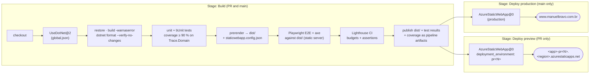

# CI/CD, hosting and domain

Decision record: [ADR-0009](adr/0009-azure-pipelines-and-static-web-apps.md) (supersedes ADR-0002).

| Piece | Choice |
|---|---|
| Source code | GitHub, `Bravodin/manuelbravo.com.br` (public, pinned on the profile) |
| CI/CD | Azure Pipelines (Azure DevOps), `azure-pipelines.yml` at the repo root |
| Hosting | Azure Static Web Apps, **Free** plan |
| Registrar | registro.br |
| DNS | Cloudflare (free plan) |
| Canonical URL | `https://www.manuelbravo.com.br` (the apex redirects here) |

## Pipeline

One YAML file with two triggers: `pr:` (pull requests into `main`) and `trigger:` (pushes to `main`). The build and test steps are identical. Only the deploy target changes.



**Gates that block a merge** ([ADR-0007](adr/0007-quality-gates.md)): build warnings, formatting drift, failing tests, Domain coverage < 90 %, any axe *serious/critical* violation, Lighthouse below the budgets in [vision.md](../product/vision.md#goals-and-success-metrics), broken internal links, a missing `hreflang` alternate. The pipeline reports its status to the GitHub PR as a check. Make that check **required** in the branch protection rules for `main`.

### Deploy step (sketch)

```yaml
- task: AzureStaticWebApp@0
  displayName: Deploy to Static Web Apps
  inputs:
    app_location: dist
    skip_app_build: true
    skip_api_build: true
    azure_static_web_apps_api_token: $(SWA_DEPLOYMENT_TOKEN)   # secret variable
    # PR builds only:
    deployment_environment: pr$(System.PullRequest.PullRequestNumber)
```

- `SWA_DEPLOYMENT_TOKEN` is a **secret** pipeline variable (or comes from a variable group). It's never written to the repo or printed in logs. Rotate it in the Azure portal (*Static Web App → Manage deployment token*) if it ever leaks.
- On `main`, leave out `deployment_environment` so the deploy goes to production.
- PRs from forks don't receive secrets. They build and test, but skip the deploy stage.
- The Free plan allows **3** preview environments, and closed PRs don't remove theirs automatically. Delete stale ones in the portal or with `az staticwebapp environment delete --name <app> --environment-name pr<N>`.

### Agents and the parallelism grant

New Azure DevOps organizations get **no free Microsoft-hosted parallel jobs** until Microsoft approves a request: <https://aka.ms/azpipelines-parallelism-request> (a few business days). After approval, a **public** project gets 10 free parallel jobs, and a **private** project gets 1 job with 1,800 minutes/month.

Until then, run a **self-hosted agent** on Manuel's Windows machine (*Project settings → Agent pools → Default → New agent*) and select it with `pool: Default`. Then switch to `pool: vmImage: ubuntu-latest` once the grant arrives.

## Prerender step (detail)


## Hosting: Azure Static Web Apps

| Setting | Value |
|---|---|
| Plan | Free |
| Deployment source | **Other** (deployed by Azure Pipelines with the deployment token, not SWA's own GitHub integration) |
| App location | `dist` (prebuilt; `skip_app_build: true`) |
| API | none |
| Custom domain | `www.manuelbravo.com.br` (certificate issued and renewed by SWA) |

### `staticwebapp.config.json`

It lives at the repo root and the prerender step copies it into `dist/`. It sets:

- **`globalHeaders`:** `Content-Security-Policy`, `X-Content-Type-Options: nosniff`, `Referrer-Policy: strict-origin-when-cross-origin`, `Permissions-Policy`. The CSP must allow what Blazor WASM needs (`'wasm-unsafe-eval'` in `script-src`), and the exact policy is validated in the spike.
- **`routes`** with long-lived caching for **fingerprinted files only**: `Cache-Control: public, max-age=31536000, immutable` on `/_framework/*` and versioned fonts and images. HTML gets a short cache or `no-cache`. The spike checks which `_framework` files actually carry a hash, since a non-fingerprinted file (for example `blazor.web.js`) must not be cached as immutable.
- **`responseOverrides`:** `404` → `/404.html`, served with a real 404 status. This is site-wide, so the single `404.html` must work in all three languages.
- **`mimeTypes`:** add `.wasm`, `.dat` and `.blat` only if SWA's defaults don't already serve them correctly.

SWA compresses responses (Brotli/gzip) on its own, so nothing is needed in the repo for that.

## Domain and DNS

The domain stays **registered at registro.br**. Its DNS moves to **Cloudflare (free)**, because an apex domain can't be a plain `CNAME` and registro.br's DNS doesn't offer ALIAS/ANAME/CNAME flattening.

### 1. Move the nameservers

1. Create a free Cloudflare account and add the site `manuelbravo.com.br`. Cloudflare imports the existing records and shows two nameservers.
2. In registro.br → *manuelbravo.com.br* → *DNS* → *Alterar servidores DNS*, replace the registro.br servers with the two Cloudflare nameservers.
3. Wait until Cloudflare marks the zone as **Active** (minutes to a few hours).

### 2. Records in Cloudflare

| Type | Name | Value | Proxy |
|---|---|---|---|
| `CNAME` | `www` | `<app>.azurestaticapps.net` | **DNS only** (grey cloud) |
| `A` | `@` | `192.0.2.1` (placeholder; never reached) | **Proxied** (orange cloud) |

- `www` is DNS-only, so SWA validates the domain and issues its own certificate. Add it in the portal: *Static Web App → Custom domains → Add → Custom domain on other DNS*, type **CNAME**.
- The apex never reaches SWA. It's proxied so that Cloudflare answers HTTPS for it and redirects. `192.0.2.1` is a reserved documentation address, which makes the intent obvious.

### 3. Apex → www redirect

In Cloudflare → *Rules → Redirect Rules*, create a rule:

- **When** hostname equals `manuelbravo.com.br`
- **Then** dynamic redirect to `concat("https://www.manuelbravo.com.br", http.request.uri.path)`, status **301**, preserve the query string.

The result is one canonical URL. Every page also declares `<link rel="canonical">` with the `www` host.

> **Alternative:** keep the apex on SWA as its second free custom domain, using Cloudflare's CNAME flattening (`CNAME @ → <app>.azurestaticapps.net`, DNS only) plus SWA's TXT validation. Then SWA serves both hosts, and the redirect has to happen elsewhere. The redirect rule above is simpler.

## Cache strategy

Fingerprinted file names (`_framework/*`, versioned fonts and images) make it safe to cache them as `immutable` for a year, so a new deploy never mixes old and new assets. HTML is small and revalidates on every visit, so a new deploy shows up immediately. All of this is set in `staticwebapp.config.json`. There's no proxy in front of `www`.
