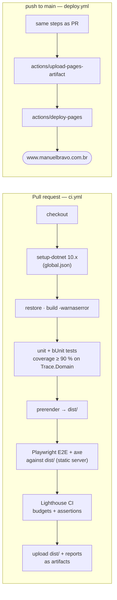
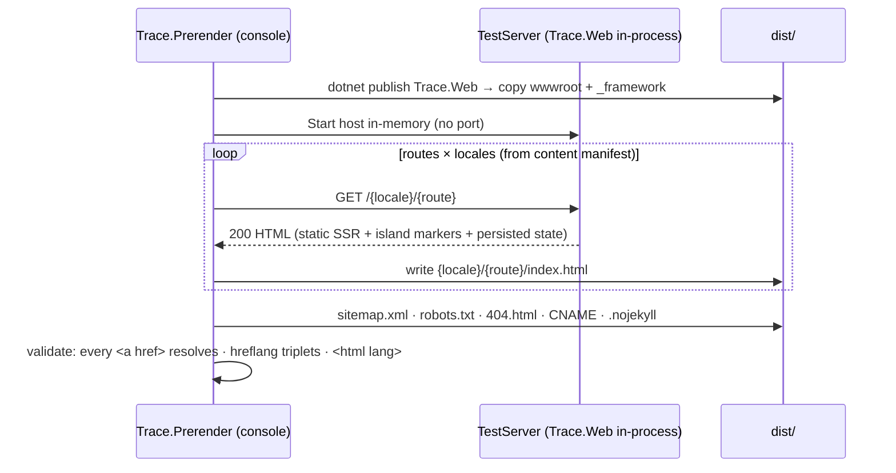

# CI/CD, hosting and domain

## Pipeline

**Gates that block a merge:** build warnings, failing tests, Domain coverage < 90 %, any axe *serious/critical* violation, Lighthouse below the budgets in [vision.md](../product/vision.md#goals-and-success-metrics), broken internal links, a missing `hreflang` alternate.

## Prerender step (detail)

## Hosting: GitHub Pages

| Setting | Value |
|---|---|
| Repository | `Bravodin/manuelbravo.com.br` (public, pinned on the profile) |
| Pages source | **GitHub Actions** (not a branch) |
| Custom domain | `www.manuelbravo.com.br` (written to `dist/CNAME` on every deploy) |
| Enforce HTTPS | ✅ (certificate issued automatically after DNS propagates) |
| Domain verification | ✅ Account Settings → Pages → *Add a domain* (TXT record) to prevent takeover |

## DNS at registro.br

In registro.br, open *Editar zona* for `manuelbravo.com.br` (use the registro.br DNS, or whichever DNS provider the domain currently points to):

| Type | Name | Value |
|---|---|---|
| `A` | `@` | `185.199.108.153` |
| `A` | `@` | `185.199.109.153` |
| `A` | `@` | `185.199.110.153` |
| `A` | `@` | `185.199.111.153` |
| `AAAA` | `@` | `2606:50c0:8000::153` |
| `AAAA` | `@` | `2606:50c0:8001::153` |
| `AAAA` | `@` | `2606:50c0:8002::153` |
| `AAAA` | `@` | `2606:50c0:8003::153` |
| `CNAME` | `www` | `bravodin.github.io.` |
| `TXT` | `_github-pages-challenge-bravodin` | *(value shown by GitHub in the domain verification step)* |

With both apex and `www` configured, GitHub Pages redirects `manuelbravo.com.br` → `www.manuelbravo.com.br`, so only one canonical URL exists.

> Check the IPs against GitHub's "Managing a custom domain for your GitHub Pages site" documentation at setup time. They have been stable for years, but the docs are the source of truth.

## Cache strategy

GitHub Pages applies the same short default cache (~10 min) to every file and doesn't allow custom headers. Fingerprinted file names (`_framework/*`, versioned fonts and images) guarantee that a new deploy never mixes old and new assets. Repeat visits still revalidate with ETags, which is cheap. If long-lived immutable caching or Brotli ever matters, put **Cloudflare (free plan)** in front as a proxy. No code change is needed (see [ADR-0002](adr/0002-hosting-github-pages.md)).
