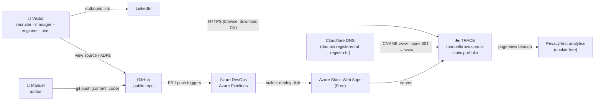
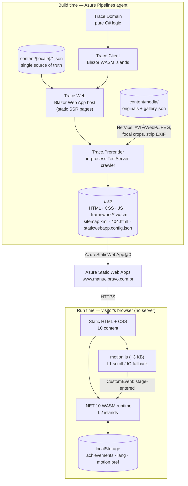
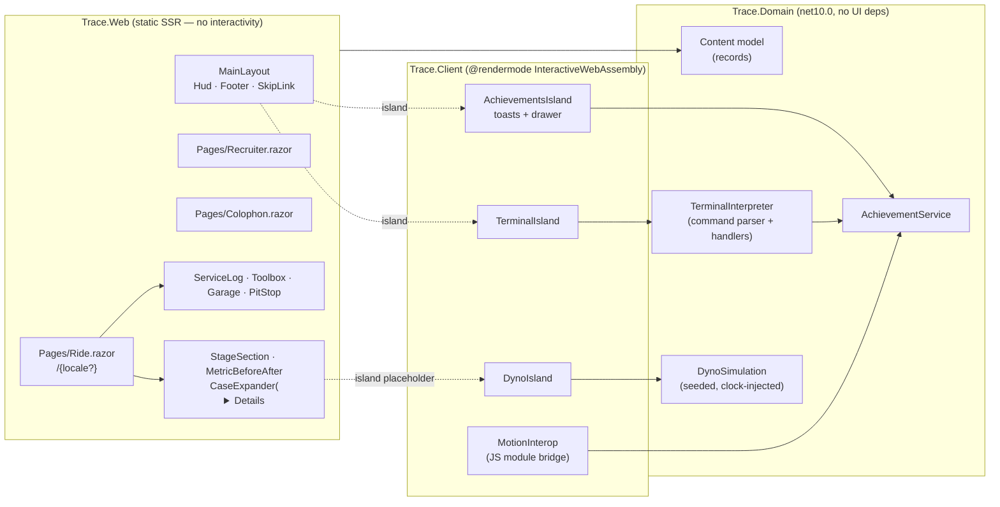
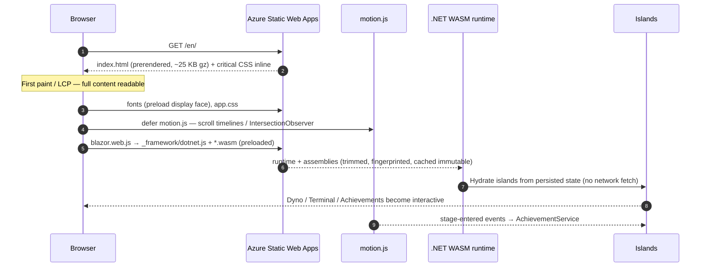

# Architecture overview

> **TL;DR:** a Blazor Web App on .NET 10 that is **rendered to static HTML at build time** and deployed to Azure Static Web Apps by Azure Pipelines. Pages are static SSR (fast, indexable, no JS required). A few **interactive WebAssembly islands** (Dyno, Terminal, Achievements) hydrate on top. Motion is CSS-first. There's no server at runtime.

The diagrams follow the [C4 model](https://c4model.com/), drawn in Mermaid.

## 1. System context



## 2. Containers (build time vs. run time)



## 3. Components



**Design rules**
- `Trace.Domain` has **no** Blazor or JS dependencies, so it's 100 % unit-testable. The Sonar-style quality gate is ≥ 90 % line coverage here.
- Islands receive content as parameters, serialized into the prerendered HTML with .NET 10 declarative persistent state (`[PersistentState]`), so they never fetch at startup.
- `TimeProvider` is injected into `DynoSimulation` and the terminal, which makes time-based behavior deterministic in tests.

## 4. First visit: runtime sequence



## 5. Repository layout (planned)

```
/
├─ content/                 # pt-BR/, en/, es/ — JSON content (see content-inventory.md)
│  └─ media/                # photo originals + gallery.json manifest (ADR-0008)
├─ src/
│  ├─ Trace.Domain/         # pure logic: achievements, dyno, terminal, content model
│  ├─ Trace.Client/         # WASM islands + JS interop
│  └─ Trace.Web/            # Blazor Web App host: pages, layout, static SSR
├─ tools/
│  └─ Trace.Prerender/      # boots Trace.Web in-process, crawls routes → dist/
├─ tests/
│  ├─ Trace.Domain.Tests/   # xUnit
│  ├─ Trace.Components.Tests/ # bUnit
│  └─ Trace.E2E/            # Playwright for .NET + axe-core, against dist/
├─ docs/                    # this documentation
├─ azure-pipelines.yml      # CI/CD (ADR-0009)
├─ staticwebapp.config.json # headers, caching, 404 (ADR-0009)
└─ global.json              # pins the .NET 10 SDK
```

## 6. Performance budget

| Asset | Budget (compressed) | Notes |
|---|---|---|
| HTML per page | ≤ 30 KB | Prerendered; critical CSS inline |
| CSS | ≤ 25 KB | One file, tokens as custom properties |
| motion.js | ≤ 5 KB | No framework |
| Fonts | ≤ 90 KB | 3 families, subset, woff2 |
| Images on the home page | ≤ 150 KB | AVIF, lazy below the fold, blurred placeholders; the portrait is the only eager image (Recruiter Mode) |
| WASM runtime + app | ≤ 2.5 MB | Trimmed, invariant globalization, lazy islands; **not** on the critical path |
| LCP (4G, mid-tier phone) | < 2.0 s | Enforced by Lighthouse CI |
| CLS | < 0.05 | Islands reserve their size in the prerendered placeholder |
| TBT | < 200 ms | WASM boot happens after load |

## 7. Key risks

| Risk | Mitigation |
|---|---|
| Interactive WASM islands from a Blazor Web App may behave differently when served from a static host | **Phase 1 spike:** deploy a single island to Static Web Apps before building the rest. Fallback documented in [ADR-0003](adr/0003-build-time-static-prerendering.md) |
| WASM payload on slow networks | Islands are optional enhancements; content is complete without them |
| A new Azure DevOps organization waits days for the free parallelism grant | Run a self-hosted agent until it's approved (see [ADR-0009](adr/0009-azure-pipelines-and-static-web-apps.md)) |
| An `immutable` cache header on a file without a hash in its name | Apply long-lived `Cache-Control` only to fingerprinted paths; checked in the Phase 1 spike |
| Preview environments fill the Free plan's 3 slots | Delete environments of closed PRs (manually first, automated later) |
| The apex domain can't CNAME to SWA on registro.br's DNS | DNS on Cloudflare; the apex 301-redirects to `www` ([ci-cd-and-hosting.md](ci-cd-and-hosting.md#domain-and-dns)) |
