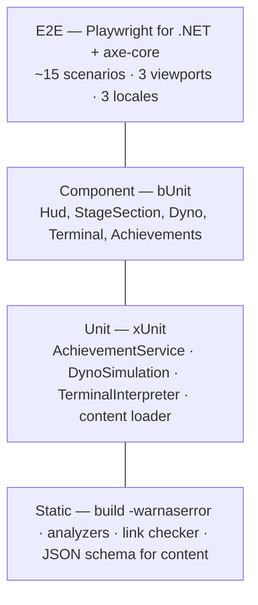

# Quality strategy

The site should show the same quality culture as the CV: BDD scenarios, automated gates, and load-and-performance thinking before go-live.

## Test pyramid



| Layer | Tooling | Gate |
|---|---|---|
| Static | Roslyn analyzers, `dotnet format --verify-no-changes`, JSON Schema validation of `content/` | 0 warnings |
| Unit | xUnit + `TimeProvider` fakes, coverlet | ≥ 90 % line coverage on `Trace.Domain` |
| Component | bUnit | All islands render from persisted state; keyboard paths |
| E2E | Playwright for .NET against `dist/` served statically | All BDD scenarios green on Chromium + WebKit |
| Accessibility | `Deque.AxeCore.Playwright` | 0 serious/critical violations |
| Performance | Lighthouse CI (mobile, simulated 4G) | Perf ≥ 90, A11y = 100, BP = 100, SEO = 100; LCP < 2 s; CLS < 0.05 |
| No-JS | Playwright with JavaScript disabled | Every page fully readable; all links work |

## BDD scenarios (Given-When-Then), v1

```gherkin
Feature: Recruiter Mode
  Scenario: Recruiter reaches the essentials in one tap
    Given I open "/en/" on a 360x740 viewport
    When I tap "Recruiter mode (30 s)"
    Then I see the role, years of experience, location and languages
    And "Download CV (PDF)" is visible without scrolling

  Scenario: Works without JavaScript
    Given JavaScript is disabled
    When I open "/en/recruiter/"
    Then all six key metrics are present in the page text

Feature: Dyno
  Scenario: Native lane finishes first
    Given the WASM islands are ready
    When I press "Run the dyno"
    Then the native lane shows "Booked" after about 1.2 seconds
    And the legacy lane is still loading
    And a screen reader announcement says "Native finished in 1.2 seconds"

  Scenario: Reduced motion
    Given my system prefers reduced motion
    When I scroll to the Client stage
    Then the Dyno shows the static result card with "Replay with motion"

Feature: Terminal
  Scenario: The punchline
    Given the terminal is open
    When I type "sudo hire manuel" and press Enter
    Then the output contains "Permission granted"
    And the "sudo hire" achievement is unlocked

  Scenario: Keyboard users can always leave
    Given the terminal is open
    When I press Escape
    Then the terminal closes and focus returns to the element that opened it

Feature: Garage gallery
  Scenario: Browse photos with the keyboard
    Given I open "/en/garage/"
    When I activate the first thumbnail
    Then a dialog opens showing the photo, its caption and the photographer credit
    When I press ArrowRight
    Then the counter shows "2 / N"
    When I press Escape
    Then the dialog closes and focus returns to the thumbnail

  Scenario: Every photo is described
    Given the media manifest
    Then every image has non-empty alt text in pt-BR, en and es
    And no published image contains EXIF metadata

Feature: Internationalization
  Scenario Outline: Each locale is complete
    When I open "<path>"
    Then <html lang> is "<lang>"
    And the page has hreflang alternates for pt-BR, en and es
    And no content key is missing
    Examples:
      | path | lang  |
      | /    | pt-BR |
      | /en/ | en    |
      | /es/ | es    |
```

## Definition of Done (per feature)

- [ ] Content exists in PT-BR, EN and ES
- [ ] Works and reads correctly with JS off (or degrades as specified)
- [ ] Keyboard path + visible focus + screen reader labels
- [ ] Reduced-motion behavior implemented
- [ ] Unit/component tests + at least one E2E scenario
- [ ] Lighthouse budgets still green
- [ ] Docs/ADR updated if a decision changed
