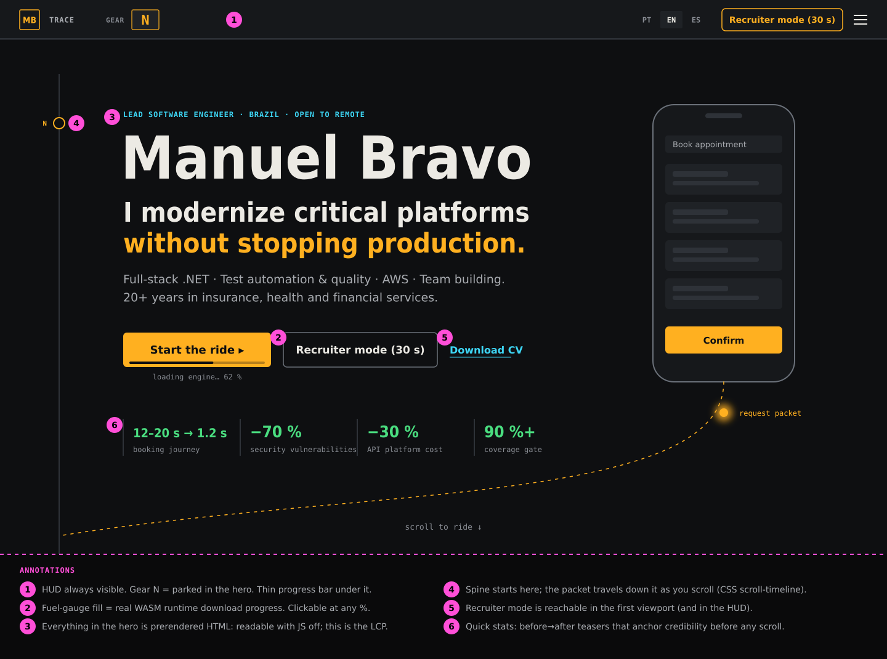
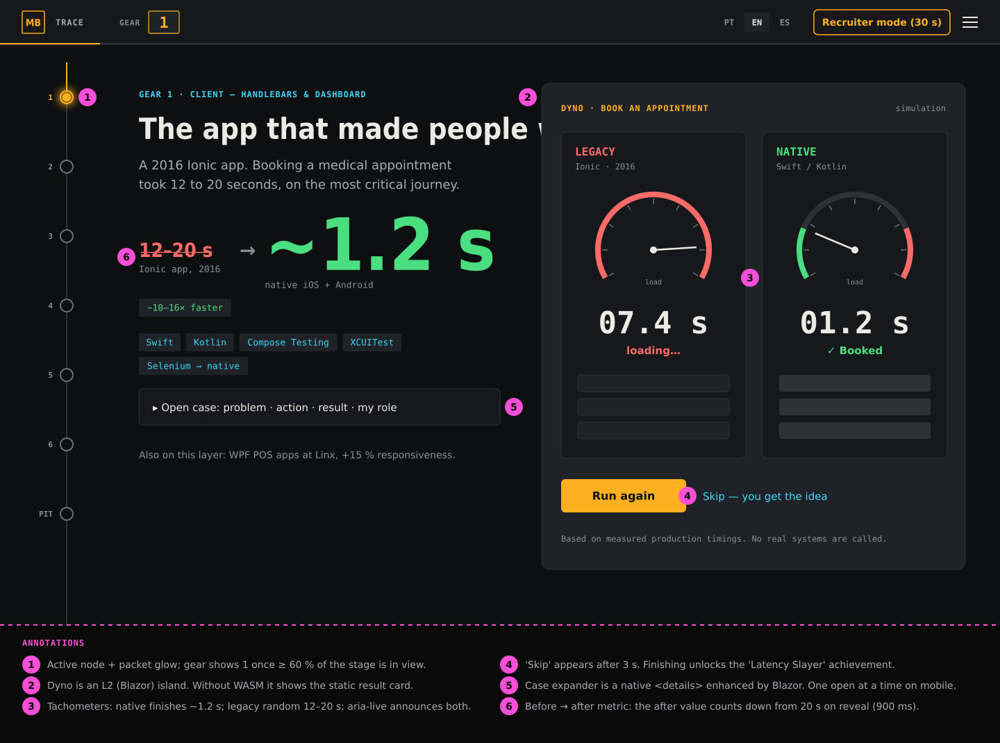
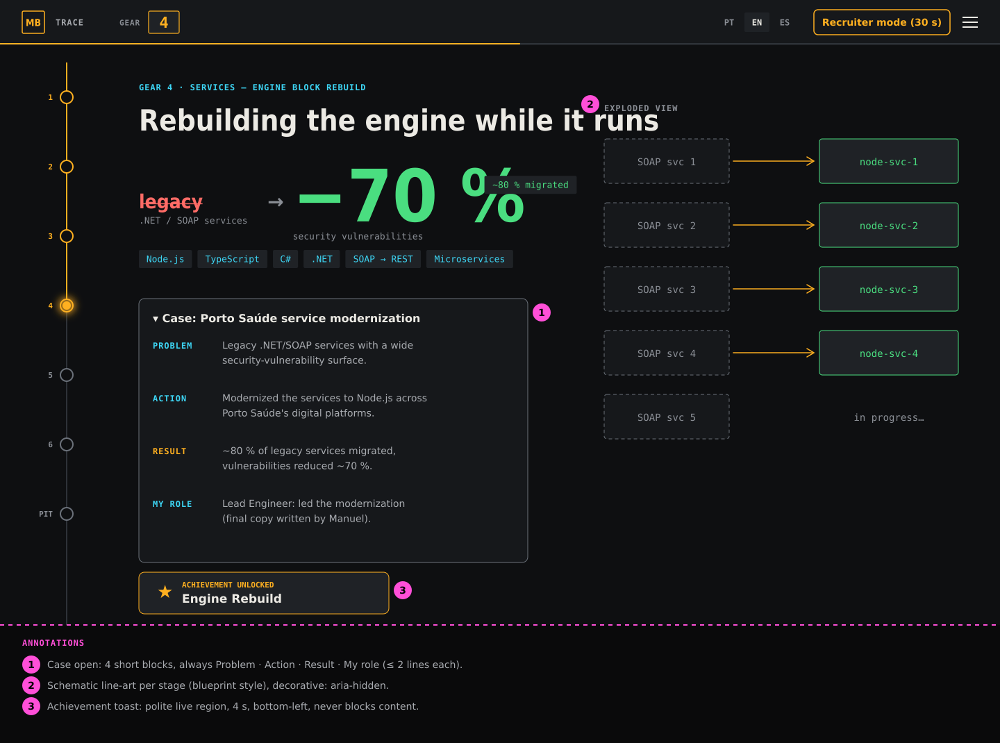
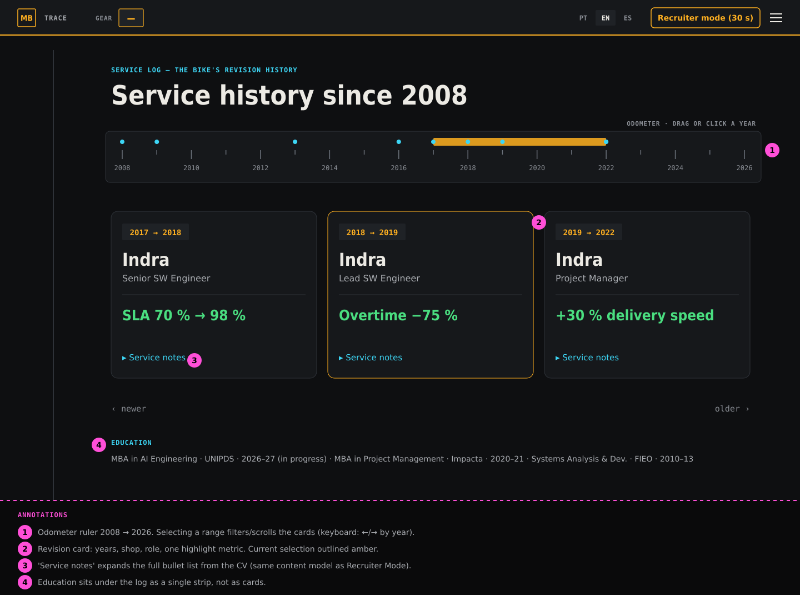
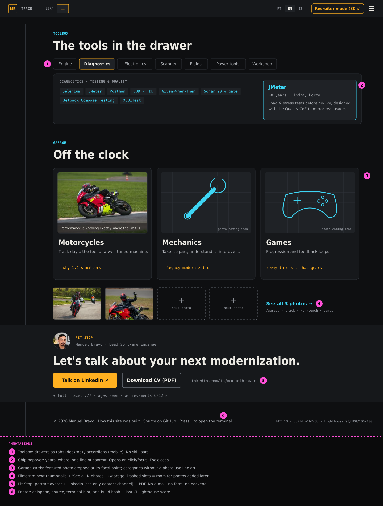
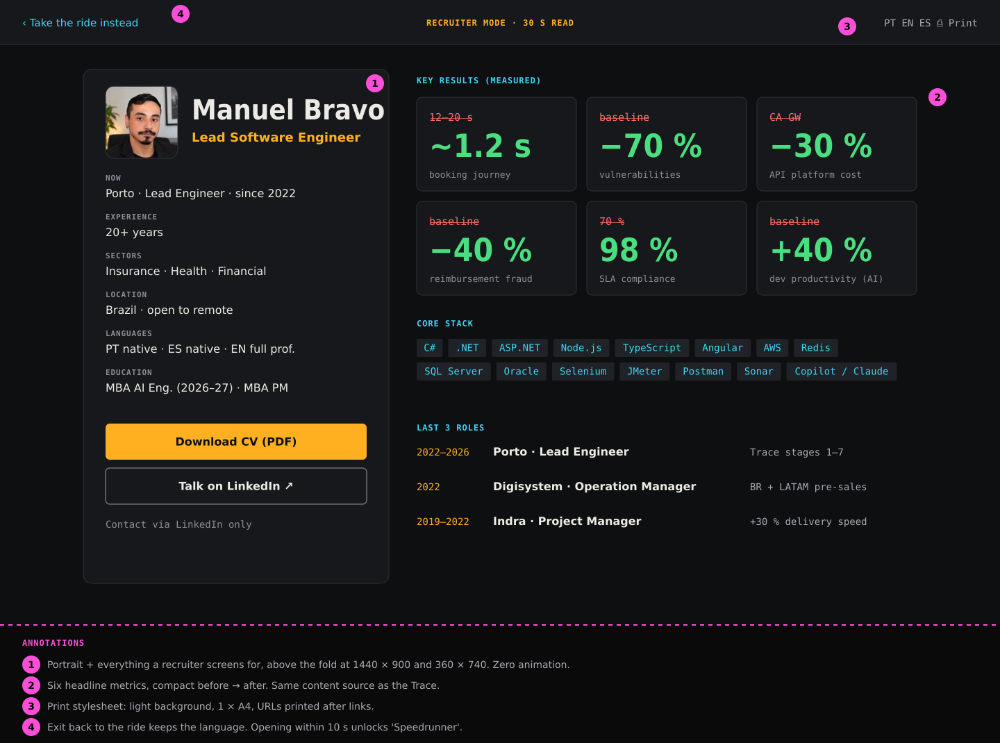
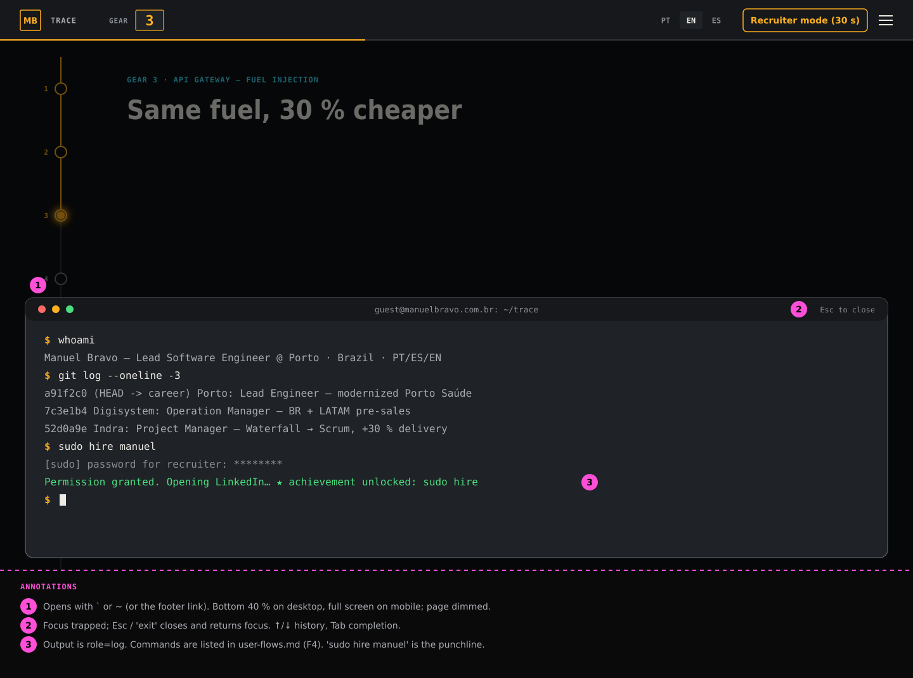
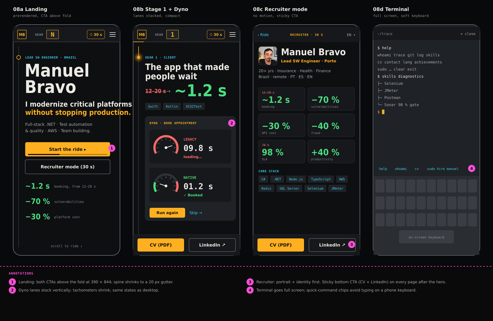
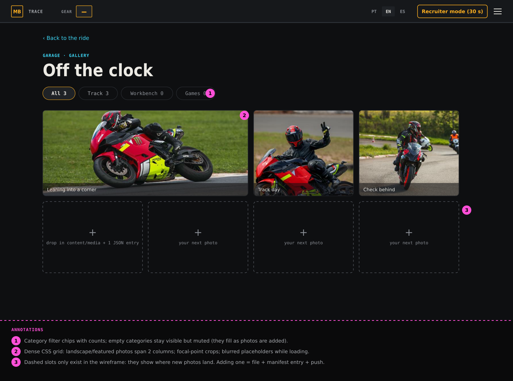
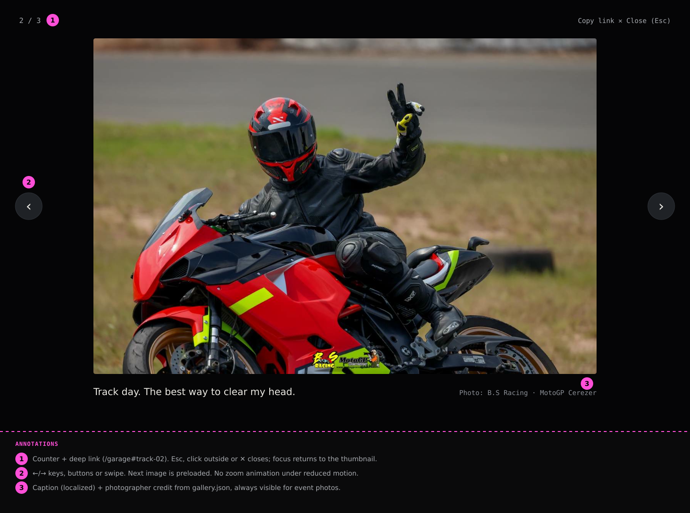

# Wireframes (mid-fidelity)

Real copy and real tokens, drawn in the site's own visual language. The pink numbered markers refer to the annotations at the bottom of each frame.

**Figma:** drag any `.svg` onto a Figma canvas and it imports as editable vectors. Install *Barlow*, *Barlow Condensed* and *JetBrains Mono* (all Google Fonts) to see the intended typography.

**Regenerate:** the frames are generated from code, so they stay consistent and diffable. The photos are read from [`content/media`](../../../content/media/README.md) (cropped at their focal point and embedded), so re-running after adding photos updates the frames. Requires Python 3 + Pillow.

```bash
python3 _src/wf_desktop.py . && python3 _src/wf_mobile.py .
```

| # | Frame | Persona focus |
|---|---|---|
| 01 | [Landing / Ignition](01-landing-desktop.svg) | All |
| 02 | [Stage 1 · Client + Dyno](02-stage-client-dyno-desktop.svg) | P2, P4 |
| 03 | [Stage 4 · Services, case open + achievement](03-stage-services-case-desktop.svg) | P2, P3 |
| 04 | [Service Log](04-service-log-desktop.svg) | P1, P2 |
| 05 | [Toolbox · Garage · Pit Stop · Footer](05-toolbox-garage-pitstop-desktop.svg) | All |
| 06 | [Recruiter Mode](06-recruiter-mode-desktop.svg) | P1 |
| 07 | [Terminal overlay](07-terminal-overlay-desktop.svg) | P3, P4 |
| 08 | [Mobile key screens](08-mobile-key-screens.svg) | P1 (mobile first) |
| 09 | [Garage gallery `/garage`](09-garage-gallery-desktop.svg) | P4 |
| 10 | [Gallery lightbox](10-gallery-lightbox-desktop.svg) | P4 |

## 01 — Landing


## 02 — Stage 1 · Client + Dyno


## 03 — Stage 4 · Services


## 04 — Service Log


## 05 — Toolbox · Garage · Pit Stop


## 06 — Recruiter Mode


## 07 — Terminal


## 08 — Mobile


## 09 — Garage gallery


## 10 — Lightbox


## Not drawn yet (v1 follow-ups)

Stages 2, 3, 5, 6 and PIT reuse the stage template from frames 02/03 with their own schematic. Also still to draw: the achievements drawer, the language banner, the 404 page ("Wrong turn") and the colophon.
