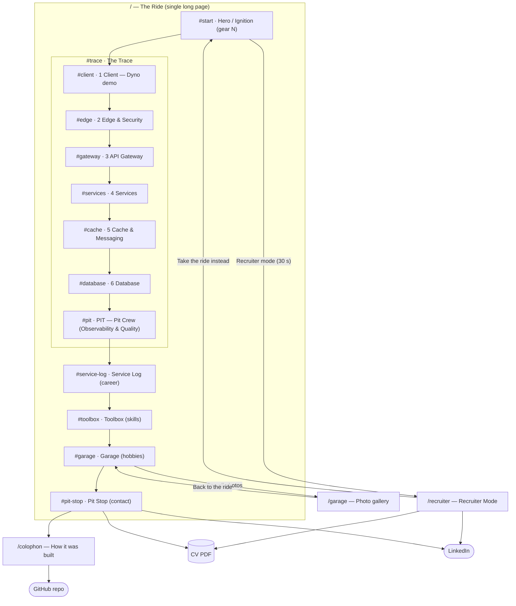

# Sitemap & information architecture

## Routes

Each route exists in three locales and is **prerendered to static HTML** at build time.

| Route (PT-BR default) | EN | ES | Purpose | Persona |
|---|---|---|---|---|
| `/` | `/en/` | `/es/` | The ride: hero + Trace + Service Log + Toolbox + Garage + Pit Stop | All |
| `/recrutador/` | `/en/recruiter/` | `/es/reclutador/` | Recruiter Mode: one screen, printable | P1 |
| `/como-foi-feito/` | `/en/colophon/` | `/es/como-se-hizo/` | How this site was built: stack, ADRs, Lighthouse, build hash | P3 |
| `/garagem/` | `/en/garage/` | `/es/garaje/` | Full photo gallery (track days, workbench, games), filterable by category, with a lightbox | P4 |
| `/404.html` | — | — | Localized "Wrong turn" page (detects locale from the path) | All |
| `/cv/manuel-bravo-{pt,en,es}.pdf` | | | Static PDF (no phone or e-mail; LinkedIn only) | P1 |

Global overlays (not routes): **Terminal** (`~` or `` ` `` key, or the footer link) and **Achievements drawer**.

## Page map



## Global navigation

| Element | Desktop | Mobile |
|---|---|---|
| **HUD** (top bar) | Logo/monogram · gear indicator · trace progress bar · language · Recruiter mode · menu | Monogram · gear · Recruiter mode · menu |
| **Section menu** | Off-canvas list of the 12 anchors, current one highlighted | Full-screen sheet |
| **Sticky CTA** | — | Bottom bar: "CV (PDF)" + "LinkedIn" after the visitor scrolls past the hero |
| **Footer** | Contact · Colophon · Source on GitHub · Terminal hint · ©/build hash | Same, stacked |

## Content hierarchy per Trace stage

```
Stage header      [gear #] [layer name] [garage metaphor icon]
Hook              one line: the problem in plain words
Metric            BEFORE → AFTER  (big)   ·  Δ chip
Case (expand)     Problem · Action · Result · My role
Tech chips        5–7 chips max
Achievement       unlocked when the stage is 60 % in view
```
