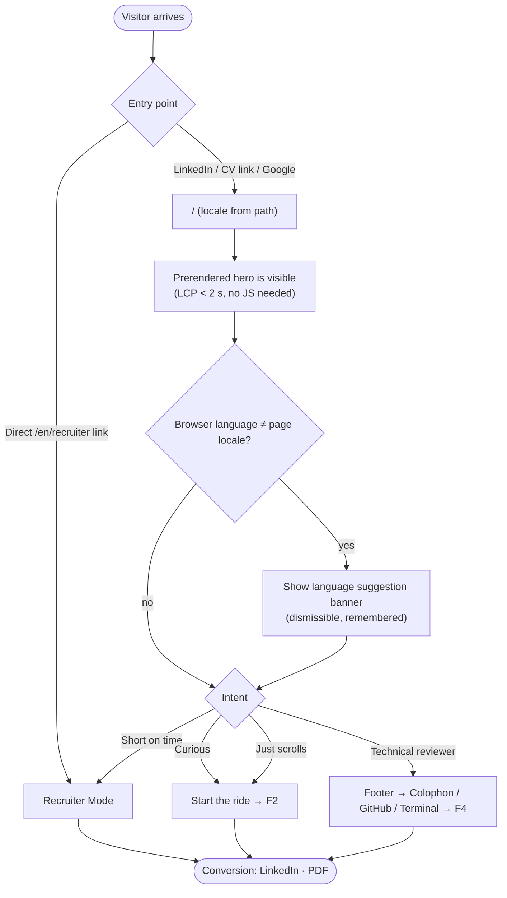
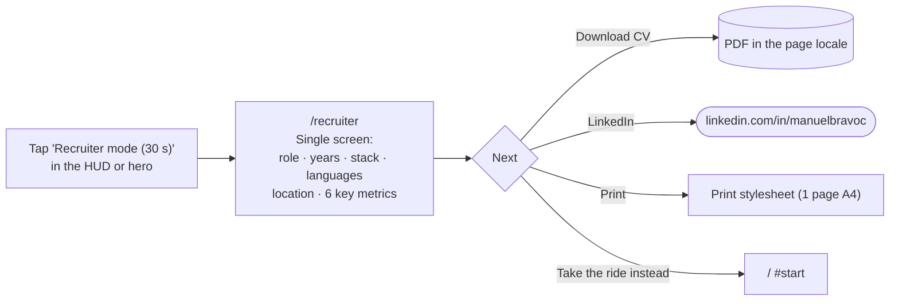
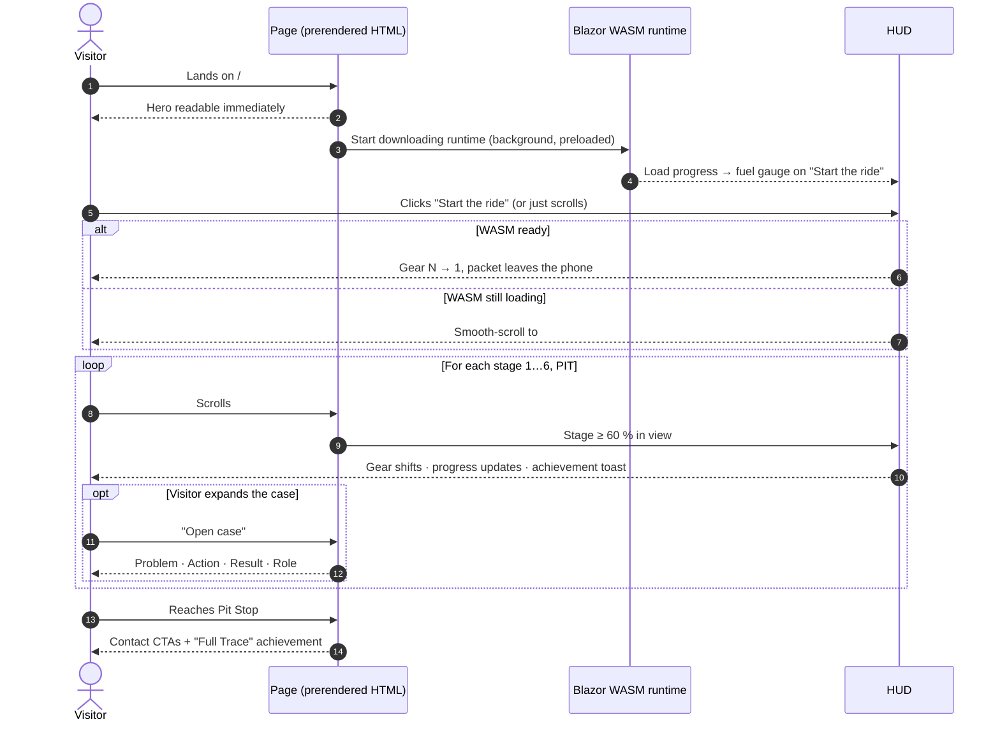
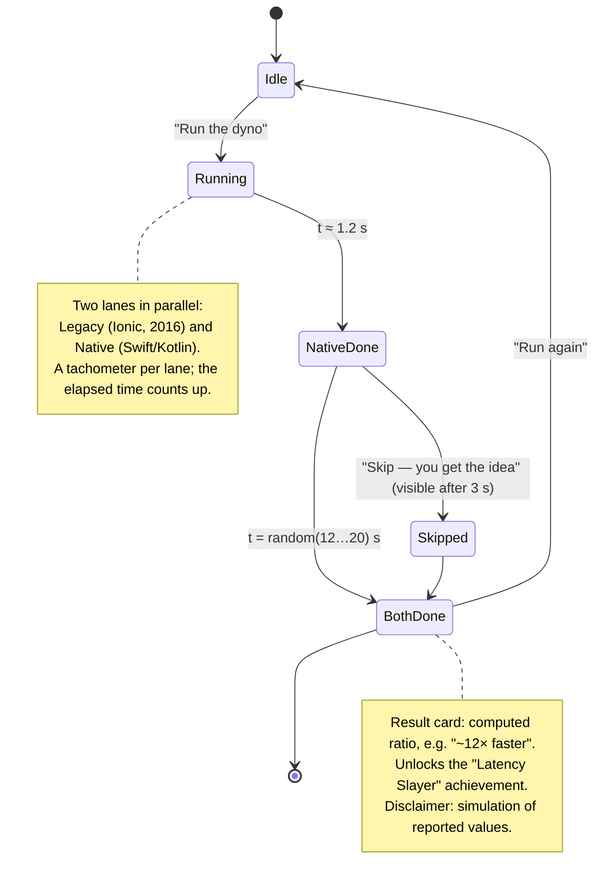
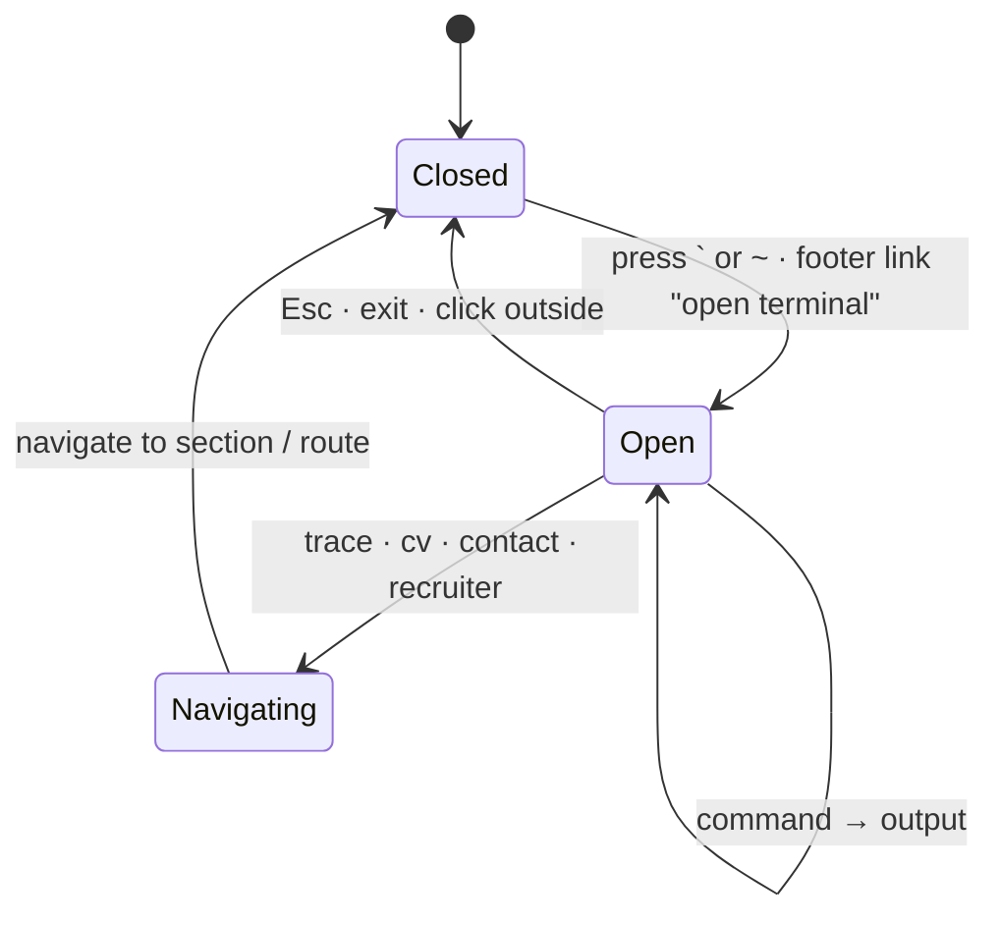
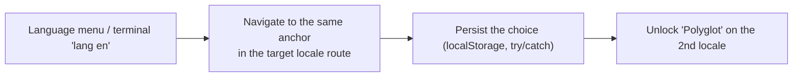
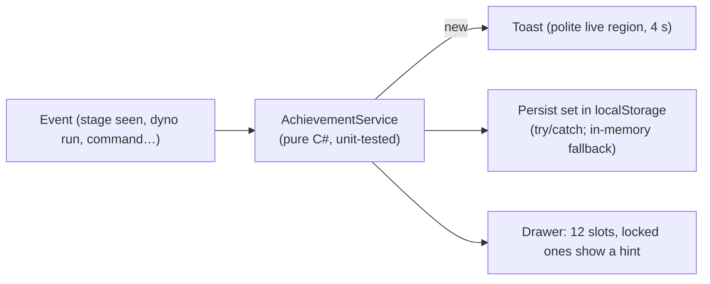

# User flows

All flows are in Mermaid, so GitHub renders them inline.

## F0 — Entry and routing by intent

## F1 — Recruiter Mode (P1, goal ≤ 30 s)

**Acceptance:** works without WASM loaded · zero animation · fits a 360 × 740 viewport with the CTAs above the fold · one A4 page when printed.

## F2 — The ride (P2, P4)

## F3 — Dyno demo (stage 1)

**Reduced motion:** the lanes don't animate; the result card is shown with the static timings and a "Replay with motion" option.

## F4 — Terminal easter egg (P3, P4)

| Command | Output |
|---|---|
| `help` | Lists the commands |
| `whoami` | Name, role, location, languages |
| `trace` | Closes the terminal and scrolls to the stage the visitor reached last |
| `git log --oneline` | Service Log as fake commits (`a1b2c3 Porto: Lead Engineer`) |
| `skills [drawer]` | Toolbox as a tree |
| `dotnet --info` | .NET version, build hash and date, Lighthouse score from the last CI run |
| `achievements` | Unlocked / locked list |
| `lang pt\|en\|es` | Switches the locale |
| `cv` | Downloads the PDF |
| `contact` | LinkedIn URL + "open" hint (the only contact channel) |
| `sudo hire manuel` | `[sudo] password for recruiter: ******` → `Permission granted. Opening LinkedIn…` + achievement |
| `clear`, `exit` | — |
| *unknown* | `command not found — try 'help'` |

## F5 — Language switch

## F6 — Achievements

| ID | Name | Trigger |
|---|---|---|
| `ignition` | First Ignition | Pressed "Start the ride" or reached stage 1 |
| `latency-slayer` | Latency Slayer | Finished a Dyno run |
| `immobilizer` | Immobilizer | Saw stage 2 |
| `engine-rebuild` | Engine Rebuild | Opened the stage 4 case |
| `no-deadlocks` | No Deadlocks | Saw stage 6 |
| `pit-crew` | Pit Crew | Reached PIT |
| `full-trace` | Full Trace | Saw all 7 stages |
| `speedrunner` | Speedrunner | Opened Recruiter Mode within 10 s of landing |
| `polyglot` | Polyglot | Used 2 locales |
| `root-access` | Root Access | Opened the terminal |
| `hired` | sudo hire | Ran `sudo hire manuel` |
| `wheelie` | Wheelie | Konami code (↑↑↓↓←→←→BA): the HUD bike does a wheelie |
